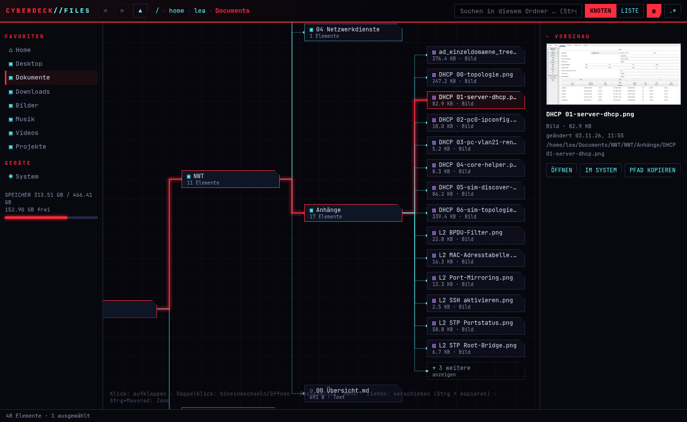

# Cyberdeck Files

Dateimanager im Cyberpunk-Look (Electron) für **Linux und Windows**.



## Funktionen
- **Knoten-Ansicht**: Ordner sind Knoten. Ein Klick klappt die Inhalte als neue Knoten auf, die mit Leitungen verbunden sind. Der aktive Pfad leuchtet rot. Große Ordner werden zu „+N weitere“ zusammengefasst.
- **Listen-Ansicht** mit Sortierung (Name, Größe, Typ, Datum)
- **Vorschau**: Bilder, Text/Code, PDF, Audio, Video
- **Dateioperationen**: neuer Ordner, umbenennen, kopieren/ausschneiden/einfügen, in den Papierkorb, Drag & Drop (Strg = kopieren)
- **Suche** im aktuellen Ordner und darunter
- Favoriten, Laufwerke/Mounts, Speicheranzeige, versteckte Dateien ein/aus
- Navigation: Pan (Ziehen), Zoom (Strg+Mausrad), Verlauf, Brotkrumen

## Tastenkürzel
| Taste | Aktion |
|---|---|
| Strg+1 / Strg+2 | Knoten / Liste |
| Enter, Doppelklick | öffnen / hineinwechseln |
| Backspace, Alt+↑ | übergeordneter Ordner |
| Alt+← / Alt+→ | zurück / vor |
| Strg+C / X / V | kopieren / ausschneiden / einfügen |
| F2 | umbenennen |
| Entf | Papierkorb |
| Strg+Umschalt+N | neuer Ordner |
| Strg+F | suchen |
| Strg+H | versteckte Dateien |
| Strg+P | Vorschau ein/aus |
| F5 | neu laden |

## Entwickeln
```bash
npm install
npm start
npm test        # e2e (headless)
npm run dist:linux   # AppImage
npm run dist:win     # Windows-Installer
```
